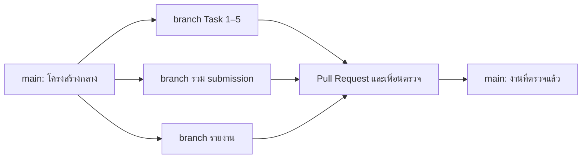

# คู่มือโครงสร้างและการแบ่ง branch สำหรับทีม

## สถานะที่ตรวจพบ

โครงสร้างพร้อมสำหรับเริ่มสำรวจข้อมูลและพัฒนา baseline แล้ว แต่ยังไม่มีโมเดลหรือ pipeline ที่เสร็จสมบูรณ์

- Task 1–3: มี `train.csv`, `test.csv` และ `datacard.txt`
- Task 4: มี `train.csv`, `test.csv`, `datacard.txt` และโฟลเดอร์ภาพ `train/`, `test/`
- Task 5: มี `test.csv` และ `datacard.txt` ไม่มี labeled train ตามชุดข้อมูลที่ได้รับ
- มี `data/raw/sample_submission.csv`
- ปัจจุบันไม่มี `data/processed/` ซึ่งไม่เป็นปัญหา สามารถเตรียมข้อมูลใน notebook และสร้างโฟลเดอร์นี้ภายหลังได้
- ตรวจชื่อไฟล์ภาพตาม CSV ของ Task 4: train 31,546 แถว และ test 25,889 แถว พบไฟล์ครบทุกแถว (ยังไม่ได้ตรวจความเสียหายภายในภาพ)
- โฟลเดอร์โค้ดแต่ละ Task มี README, requirements และพื้นที่ notebooks แล้ว
- `scripts/` มี README อธิบายงานที่ต้องเพิ่ม ยังไม่มีสคริปต์รวมและตรวจ submission
- ขณะตรวจ local repository อยู่ที่ `main` แต่ยังไม่มี commit แรก และกำหนด remote `origin` แล้ว

สถานะข้างต้นเป็นการตรวจในเครื่องผู้จัดเตรียม สมาชิกต้องจัดวางข้อมูลในเครื่องของตนเองด้วย

## โฟลเดอร์แต่ละส่วนใช้ทำอะไร

```text
Player-Intelligence-System-CPE342-ML/
├── README.md                 วิธีเริ่มใช้งานโปรเจกต์
├── TEAM_GUIDE.md             คู่มือการทำงานร่วมกันฉบับนี้
├── .gitignore                กำหนดไฟล์ที่ไม่ส่งขึ้น Git
├── requirements.txt          Dependencies ส่วนกลาง
├── reference/                เอกสารอ้างอิงและข้อกำหนด
├── data/
│   ├── raw/
│   │   ├── sample_submission.csv
│   │   ├── Task1/            train.csv, test.csv, datacard.txt
│   │   ├── Task2/            train.csv, test.csv, datacard.txt
│   │   ├── Task3/            train.csv, test.csv, datacard.txt
│   │   ├── Task4/            CSV, datacard และภาพใน train/, test/
│   │   └── Task5/            test.csv, datacard.txt
│   └── processed/            ตัวเลือกเสริม ปัจจุบันไม่มี สร้างเมื่อจำเป็น
├── Task1/                    โค้ดงานตรวจผู้เล่นโกง
├── Task2/                    โค้ดงานแบ่งกลุ่มผู้เล่น
├── Task3/                    โค้ดงานทำนายยอดใช้จ่าย
├── Task4/                    โค้ดงานจำแนกภาพเกม
├── Task5/                    โค้ดงานตรวจบัญชีผิดปกติ
├── models/                   โมเดลที่ฝึกแล้ว แยก Task1–Task5
├── scripts/                  พื้นที่สำหรับโค้ดรวมและตรวจผลทั้ง 5 งาน
├── submissions/              ผลทำนายแต่ละงานและ CSV รวม
└── reports/
    ├── figures/              กราฟและภาพสำหรับรายงาน
    └── experiments/          บันทึกวิธีทดลองและผลที่ได้
```

ภายใน `Task1/` ถึง `Task5/` มี `README.md`, `requirements.txt` และ `notebooks/`
ให้เจ้าของงานเพิ่ม notebook เช่น `Task1/notebooks/baseline.ipynb`
ภายหลังอาจแยก `train.py` และ `predict.py` เพื่อให้รันซ้ำสะดวกขึ้น

`Task1/` เก็บโค้ด ส่วน `data/raw/Task1/` เก็บข้อมูล ไม่ต้องย้ายข้อมูลมาไว้ข้าง notebook
ใช้ path ที่อิงตำแหน่งโปรเจกต์และระบุ working directory ให้ชัดเจน หลีกเลี่ยง path เฉพาะเครื่อง เช่น `C:/Users/ชื่อเพื่อน/...`

## ถ้าทำทุกอย่างใน notebook

สามารถอ่าน raw data → ทำ EDA → แบ่ง train/validation → เตรียมข้อมูล → ฝึกและประเมิน → ทำนาย ได้ใน notebook เดียว
ก่อนส่งงานให้ restart kernel และรันทุกเซลล์ตามลำดับเพื่อยืนยันว่าสร้างผลซ้ำได้

- `processed/` ไม่บังคับใช้: บันทึกเมื่อเตรียมข้อมูลนานหรือต้องการนำผลกลับมาใช้ซ้ำ
- `models/` ไม่บังคับใช้: แนะนำให้บันทึกโมเดลที่ฝึกนาน พร้อม preprocessing, class mapping และลำดับ features
- `submissions/` ใช้เก็บผลทำนายที่จะนำไปรวม
- Fit ตัวเติมค่าว่าง, scaler หรือ encoder เฉพาะ training partition ของรอบประเมินนั้น

## แบ่ง branch อย่างไร

Branch เป็นเวอร์ชันของทั้ง repository ไม่ใช่โฟลเดอร์เพิ่ม สมาชิกทุกคนยังเห็นโครงสร้างครบทุก Task
การแยก branch ช่วยให้แต่ละคนแก้และทดลองงานของตนเอง ก่อนรวมผ่าน Pull Request (PR)

| Branch ที่แนะนำ | ผู้รับผิดชอบ | งานหลัก |
|---|---|---|
| `main` | ทั้งทีม โดยมีผู้ดูแลการ merge | งานที่ผ่านการตรวจแล้วและสถานะล่าสุดที่ทีมใช้ร่วมกัน |
| `task1/anti-cheat` | เจ้าของ Task 1 | EDA, baseline, tuning และผลทำนาย Task 1 |
| `task2/player-segment` | เจ้าของ Task 2 | EDA, baseline, tuning และผลทำนาย Task 2 |
| `task3/spending` | เจ้าของ Task 3 | EDA, baseline, tuning และผลทำนาย Task 3 |
| `task4/game-classification` | เจ้าของ Task 4 | ภาพ, โมเดล, class mapping และผลทำนาย Task 4 |
| `task5/anomaly-detection` | เจ้าของ Task 5 | ตรวจเงื่อนไขข้อมูลและพัฒนา anomaly detection |
| `chore/submission-pipeline` | ผู้รวมผลที่ทีมแต่งตั้ง | สคริปต์รวมผลและตรวจ submission |
| `docs/report` | ผู้ประสานรายงาน | เรียบเรียงรายงานและรวมผลการทดลอง เมื่อเริ่มเขียนรายงาน |

ตารางนี้เป็นแผนการตั้งชื่อ ยังไม่ได้สร้าง branch เหล่านี้
สร้างเฉพาะเมื่อเริ่มทำงานนั้น ไม่จำเป็นต้องสร้างทั้งหมดพร้อมกัน และยังไม่ต้องเพิ่ม `develop`
ผู้รวมผลและผู้ประสานรายงานสามารถเป็นเจ้าของ Task คนใดคนหนึ่งได้



## เริ่มทำงานร่วมกัน

### ผู้จัดเตรียม repository ทำครั้งแรก

ตรวจ `git status` ว่าจะ commit เฉพาะโครงสร้างและเอกสาร ไม่รวมข้อมูลหรือ secrets
คำสั่งต่อไปนี้เป็นตัวอย่างให้ผู้จัดเตรียมรัน ยังไม่ได้ดำเนินการให้:

```powershell
git add .gitignore README.md TEAM_GUIDE.md requirements.txt reference Task1 Task2 Task3 Task4 Task5 scripts reports data models submissions
git status
git commit -m "Set up shared ML project structure"
git push -u origin main
```

หาก remote มีประวัติอยู่แล้ว ให้ตรวจและรวมประวัติก่อน push ไม่ใช้ force push ทับงานของเพื่อน

### สมาชิกแต่ละคนเริ่มงาน

หลังโครงสร้างกลางถูก push แล้ว ให้ clone repository และวางข้อมูลจากแหล่งที่ทีมตกลงกัน:

```powershell
git clone https://github.com/JeffMerry/Player-Intelligence-System-CPE342-ML.git
cd Player-Intelligence-System-CPE342-ML
git switch -c task1/anti-cheat
```

เปลี่ยนชื่อ branch ให้ตรงกับงานของตน หากมี local repository อยู่แล้ว ให้ทำงานค้างให้เรียบร้อยก่อน:

```powershell
git switch main
git pull --ff-only origin main
git switch -c task1/anti-cheat
```

ใช้ `git switch -c` เฉพาะตอนสร้าง branch ใหม่ หากมี branch นั้นอยู่แล้ว ใช้ `git switch ชื่อ-branch`

### ส่งงานให้เพื่อนตรวจ

ตัวอย่างเจ้าของ Task 1:

```powershell
git add Task1/
git status
git commit -m "Add Task 1 baseline notebook"
git push -u origin task1/anti-cheat
```

เปิด PR จาก branch งานเข้า `main` ระบุสิ่งที่ทำ วิธีรัน ผล validation จริง และข้อจำกัด
ให้เพื่อนอย่างน้อยหนึ่งคนตรวจ ก่อนผู้ดูแล merge
เมื่อ PR ถูก merge แล้ว งานรอบถัดไปให้สร้าง branch ใหม่จาก `main` ล่าสุด เช่น `task1/threshold-tuning`

หากทำ branch เดิมค้างอยู่และต้องรับงานใหม่จากเพื่อน ให้ commit งานของตนก่อน จากนั้น:

```powershell
git fetch origin
git merge origin/main
```

หากเกิด conflict ให้แก้โดยตรวจความหมายของทั้งสองฝั่ง และรันงานที่เกี่ยวข้องอีกครั้ง
หลีกเลี่ยงการแก้ notebook ไฟล์เดียวพร้อมกันหลายคน เพราะ merge ยาก

## ข้อตกลงการส่งต่อผล

- เจ้าของแต่ละ Task รับผิดชอบโค้ดในโฟลเดอร์ของตน และบันทึกผลใน `reports/experiments/`
- เพิ่ม dependencies เฉพาะงานใน `TaskN/requirements.txt` พร้อมระบุเวอร์ชันที่ใช้จริง
- ประสานผู้ดูแลก่อนเปลี่ยน dependencies ส่วนกลางหรือรูปแบบผลทำนาย
- แต่ละ Task ส่ง CSV ที่มี `id,taskN` และหนึ่งผลทำนายต่อ submission ID เมื่อยืนยันวิธี mapping แล้ว
- ผู้รวมผลตรวจให้ตรงกับ `sample_submission.csv` ทั้ง ID, ลำดับแถว, คอลัมน์ และค่าที่อนุญาต
- ข้อมูล โมเดล และ CSV ผลทำนายถูก ignore โดย Git การ push branch จึงไม่ส่งไฟล์เหล่านี้ให้เพื่อน
- ตกลงแหล่งแชร์ไฟล์ภายในทีม และแนบ commit, seed, วิธีรัน และเวอร์ชันโมเดลกับผลทำนายทุกครั้ง
- ไม่แชร์โค้ดหรือผลทำนายกับทีมอื่นตามข้อกำหนดในคู่มือ

## เรื่องที่ต้องยืนยันก่อนส่ง Kaggle

- Task 2: วิธีเฉลี่ย F1 ที่ scorer ใช้
- Task 4: datacard และ sample มีตัวเลขคลาส แต่คู่มือสรุประบุชื่อเกม ต้องยืนยันรูปแบบทางการ
- Task 4: CSV จริงมี `file_name` สำหรับชื่อไฟล์ภาพ ให้ใช้คอลัมน์นี้และตรวจไฟล์จริง ไม่สมมติว่าเป็น `{id}.jpg`
- วิธี mapping IDs: ข้อมูลตารางใช้ `player_id` แต่ sample ใช้ `ANS...` ต้องมีหลักฐานวิธีจับคู่ก่อนรวมผล
- Task 5: วิธี fit แบบ unsupervised ในกรณีมีเฉพาะ test โดยไม่ขัดข้อห้ามฝึกบน test

เอกสารนี้อธิบายวิธีจัดงานของทีม ส่วนกติกาการแข่งขันให้ยึดแหล่งทางการเป็นหลัก
